# How the Pstack Based Factory works

This document explains how the factory decides what to run, when, and in what order. For setup and commands, see the
[root README](../README.md). The diagrams render on GitHub.

- [The big picture](#the-big-picture)
- [Words used here](#words-used-here)
- [Where everything lives](#where-everything-lives)
- [From an idea to a merged pull request](#from-an-idea-to-a-merged-pull-request)
- [The life of a task](#the-life-of-a-task)
- [When a task may start](#when-a-task-may-start)
- [Hands-on and hands-off](#hands-on-and-hands-off)
- [How dependencies are decided](#how-dependencies-are-decided)
- [The loop: a scheduler that never waits](#the-loop-a-scheduler-that-never-waits)
- [What happens to a pull request](#what-happens-to-a-pull-request)
- [Stacked tasks](#stacked-tasks)
- [When things go wrong](#when-things-go-wrong)
- [Projects and project dependencies](#projects-and-project-dependencies)
- [Changing a task after its PR is open](#changing-a-task-after-its-pr-is-open)
- [Deleting and completing](#deleting-and-completing)
- [What is code and what is a skill](#what-is-code-and-what-is-a-skill)
- [The visualizer](#the-visualizer)
- [Module map](#module-map)
- [Known limits](#known-limits)

## The big picture

You describe what you want. The factory splits it into tasks, turns each task into a pull request, reviews it, and
fixes what the review finds. You merge. Nothing merges without you.

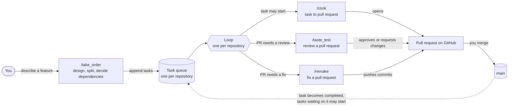

Three things make this more than a loop over a list:

- **Order.** A task that depends on another runs after it, never beside it. Tasks with no dependency between them
  run at the same time.
- **Trust.** You choose, per task, session, project or for the whole factory, whether a dependent task waits for your
  merge (hands-on) or only for a clean review (hands-off).
- **Reach.** One factory manages many repositories. Each gets its own queue and its own loop.

## Words used here

| Word | Meaning |
|---|---|
| Task | One unit of work, small enough to deliver as one pull request. |
| Session | The tasks one `/take_order` call created. It never grows. |
| Project | A GitHub repository the factory manages. One per repository, named `owner/repo`, never named by hand. |
| Dependency | A task another task must wait for. |
| Project dependency | A project another project waits for as a whole. |
| Completed | A task whose PR was merged, or that you marked completed. Final. |
| Deleted | A task you removed for good, with every record of it. |
| Parked | A task the loop stopped trying. It waits for you. |
| Hands-on | A task that depends on this one waits until this one is merged. |
| Hands-off | A task that depends on this one may start once this one has passed review cleanly. |

The full list is in [GLOSSARY.md](../GLOSSARY.md).

## Where everything lives

The factory's code lives in this repository. Its data lives in one folder in your home directory, outside every
repository it manages. A managed repository receives branches and pull requests and nothing else.

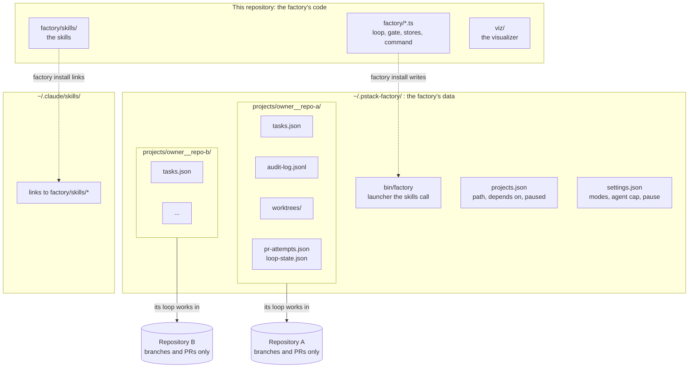

`PSTACK_FACTORY_HOME` moves the home folder. `factory/home.ts` is the only place that builds these paths.

A repository becomes a project in one of three ways: the first time `/take_order` runs in it, when you add it in the
visualizer by the path of its folder, or with `factory register <path>`. The project's name comes from the
repository's GitHub `origin` remote.

## From an idea to a merged pull request

This is one task with no dependencies, in a repository that is already a project.

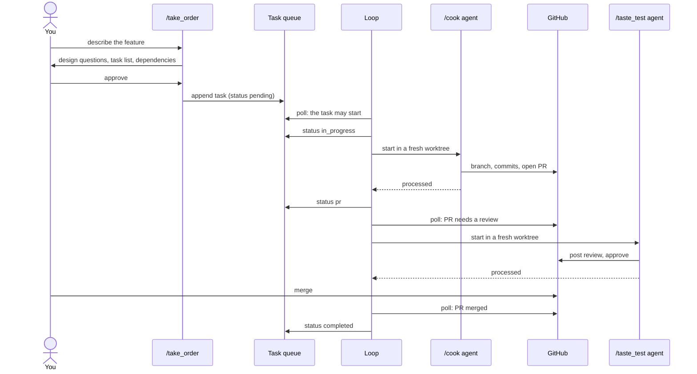

## The life of a task

A task's `status` is owned by the loop. Parking is a note on a pending task, not a status of its own.

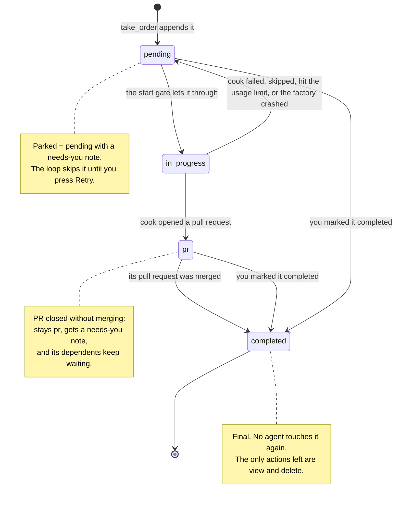

Deleting is not a status. A deleted task is gone from the queue, and so are its audit lines, attempt counts and run
transcripts.

## When a task may start

A task with no dependencies may start the moment it exists. A task with dependencies waits until every one of them is
met. `factory/gate.ts` decides this from recorded facts only: task statuses, the open pull requests, the last
reviewed commit of each, and the modes. No agent and no skill takes part.

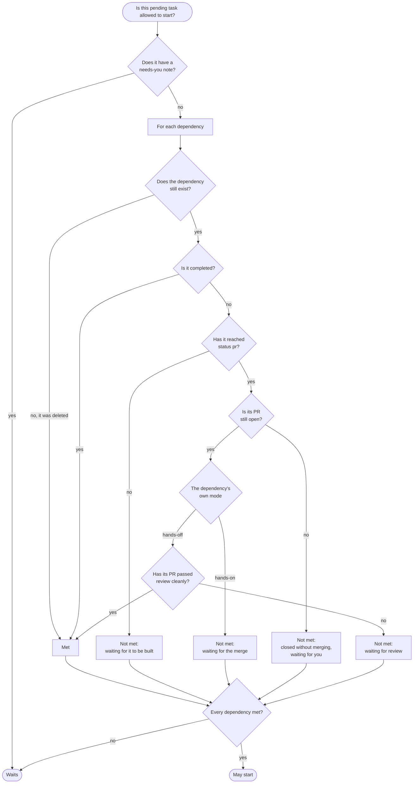

Two details matter here.

**The dependency's mode decides, not the waiting task's.** If A is hands-on and B depends on A, B waits for A's
merge even when B itself is hands-off. If A is hands-off, B may start once A is clean even when B is hands-on. With
several dependencies, each is judged by its own mode and all must be met.

**"Passed review cleanly" has an exact meaning.** All four must hold on the dependency's open PR:

1. `/taste_test` reviewed the PR's current head commit and left no `changes-requested` label.
2. CI is passing.
3. GitHub reports no merge conflict with main. "Not computed yet" does not count as a pass.
4. No `/remake` or `/customize_order` comment is waiting for an answer.

A new commit or a CI failure removes the clean state until the PR is reviewed again.

## Hands-on and hands-off

The same two tasks, B depending on A, under each mode.

**A is hands-on.** B waits for your merge.

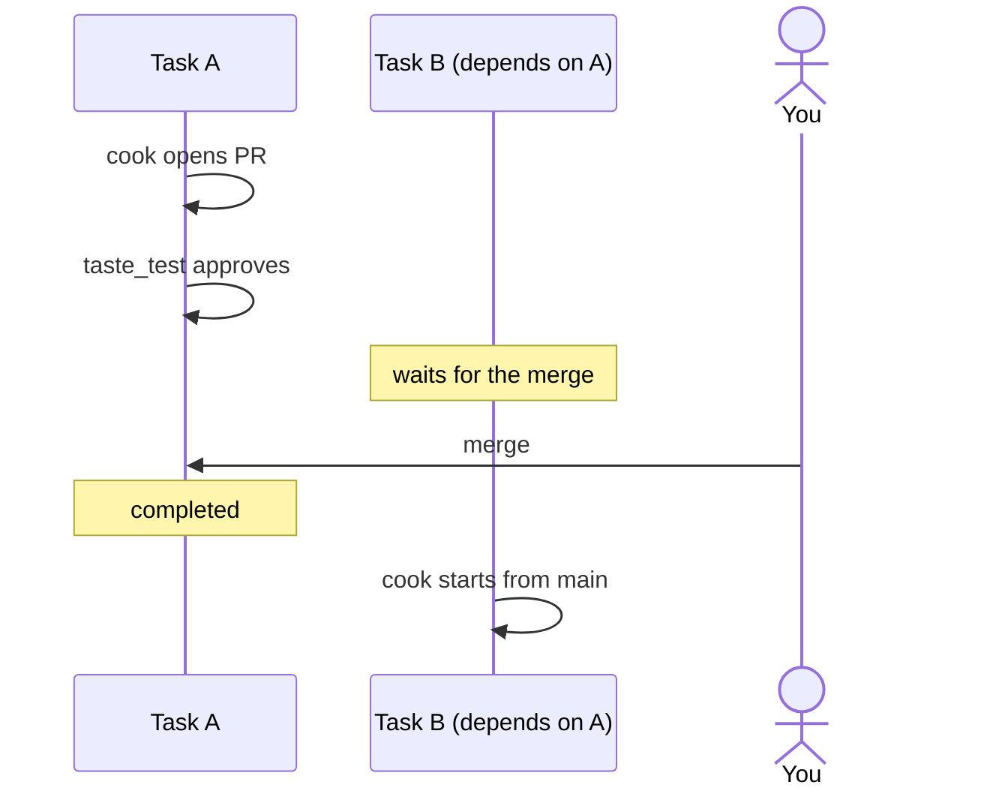

**A is hands-off.** B starts as soon as A is clean.

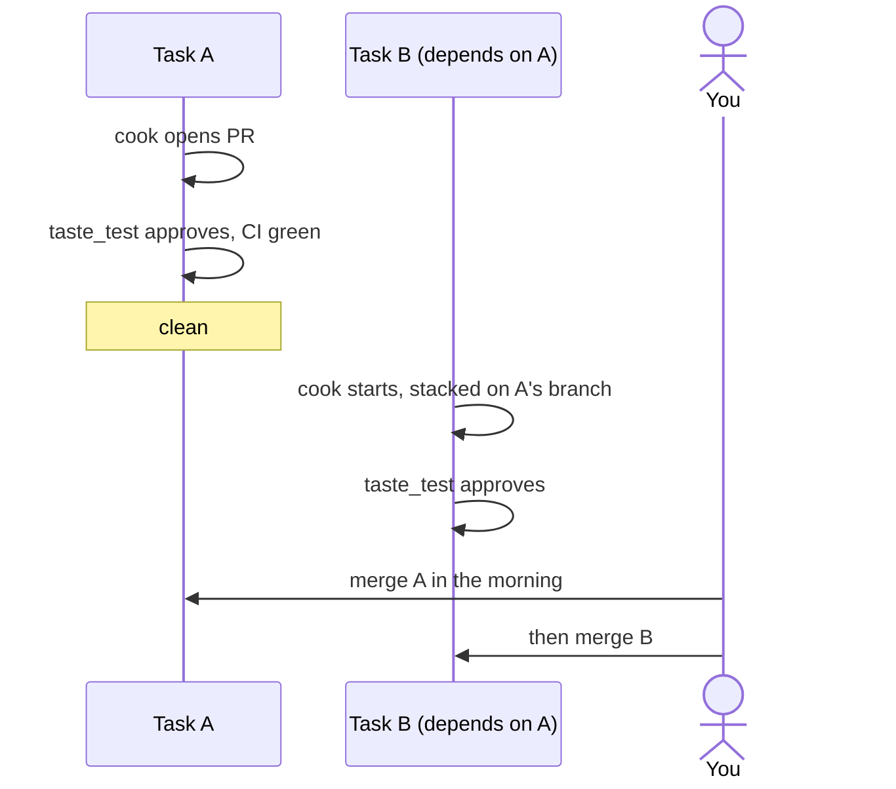

Hands-on is the default. Use hands-off when you want a chain of dependent tasks to keep moving while you are away.

### Where the mode comes from

The mode is set at four levels. The most specific level that sets one wins.

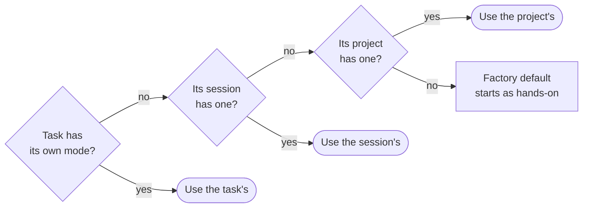

Each level has a switch in the visualizer: the top bar for the factory default, a project's heading, a session's
card, and a task's row. A level that sets its own mode shows what it overrides and has a reset that makes it inherit
again.

A flip only changes future starts. It never stops a running agent and never closes a PR. Flipping one level never
changes another level's setting.

## How dependencies are decided

Deciding whether two tasks clash is a judgement, so a skill makes it. Everything around that judgement is code, so
that no task is skipped because an agent thought it looked unrelated.

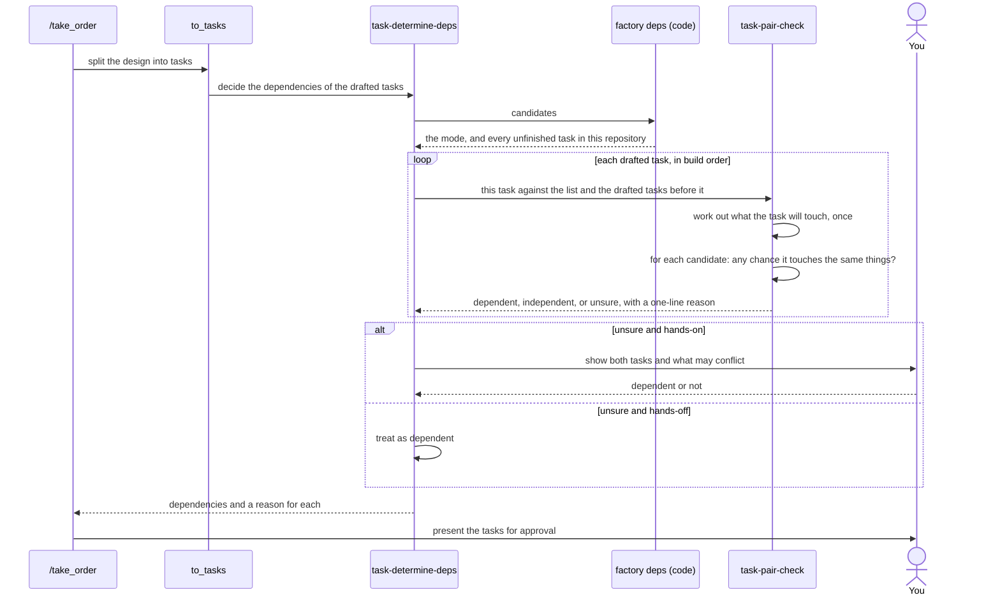

The rules behind it:

- **What is compared.** Every unfinished task in the same repository, from any session. Completed and deleted tasks
  are never listed. Tasks in another repository are never dependencies; see
  [Projects and project dependencies](#projects-and-project-dependencies).
- **What makes a dependency.** Both tasks are likely to edit the same file, or one changes something the other
  relies on (a function, a type, a schema, a config value), or anything else makes it unsafe to work on both at once
  (the same lockfile, the same CI config, the same migration).
- **Direction.** A new task waits for an existing one. An existing task never gains a dependency on a newer task,
  which is why dependencies cannot form a cycle. Among the tasks of one order, the one that others build on goes
  first.
- **Doubt.** The pair check answers `independent` only when it is certain. Any doubt is `unsure`. In hands-on mode
  you are asked about that pair. In hands-off mode doubt means dependent. A wrong dependency costs time; a wrong
  independence costs merge conflicts.
- **Reasons.** Each dependency stores one line saying why it exists. The visualizer shows it, and lets you add or
  remove a dependency by hand.

The footprint a task will touch is worked out fresh each time and never stored.

## The loop: a scheduler that never waits

`bun run loop` starts a supervisor. It runs one loop per project, picks up a newly registered project within 10
seconds, restarts a loop that crashed, and stops the loop of a project you removed.

Each loop is a scheduler. It polls every 60 seconds, and again the moment any of its agents finishes. It never waits
on an agent, so it keeps noticing new tasks and PRs while agents work.

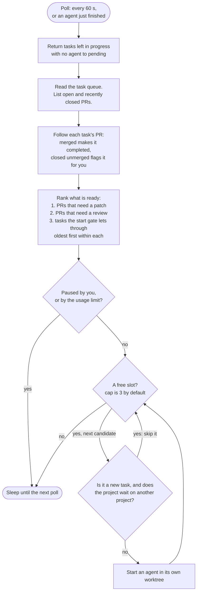

The ranking finishes work before it starts more. A PR that needs a fix is closer to mergeable than a PR that needs a
review, which is closer than a task nobody has started. This is also what stops reviews from being starved by a long
queue of tasks.

### One worktree per agent

Agents never share a checkout and never touch yours.

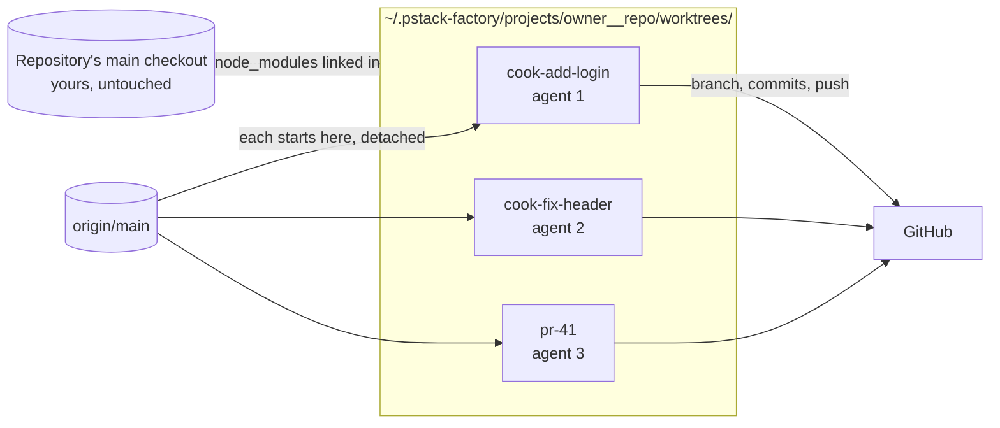

A worktree is created when its agent starts and removed when it ends. The agent's transcript is then moved next to
the main checkout's, so the visualizer's history and Take over still find it.

### What an agent is allowed to do

Each agent runs as `claude -p "/<skill> <target>"` with a fixed list of allowed tools: file reading and editing,
subagents, and Bash limited to `git`, `gh`, `bun`, the factory's own `factory` command, and a few read-only helpers
(`grep`, `sort`, `uniq`, `diff`, `cut`, `tr`, `basename`, `dirname`, `pwd`, `which`, `file`, `stat`, `realpath`, and
the like). It ends with a schema-checked report: `processed`, or `skipped` with a reason.

A project whose checks need another tool adds it to its own `allowedCommands`: run `factory commands set conda python
pytest` in the repository, or `factory commands` to see the list. Each entry must be a bare command name; `sudo`, the
shells, `env`, `xargs` and `eval` are refused, as are `find` and `awk`, because they can run other commands. The
supervisor re-reads the list at every agent start, so a change reaches the next run without restarting the loop.

## What happens to a pull request

Every open PR in a project is a candidate, the factory's own included. `factory/pr-state.ts` decides what each one
needs. The first rule that matches wins.

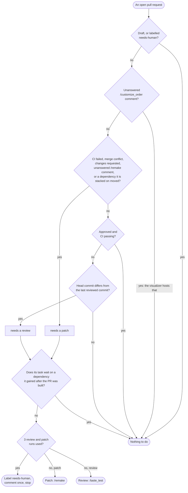

`/taste_test` cannot use GitHub's "request changes" on a PR the factory itself opened, so it sets a
`changes-requested` label instead. `/remake` clears the label after its fix. A new `/remake` comment, or a finished
`/customize_order`, resets the count of three.

## Stacked tasks

In hands-off mode a task can start before its dependency is merged. Its code then has to be built on top of the
dependency's unmerged branch.

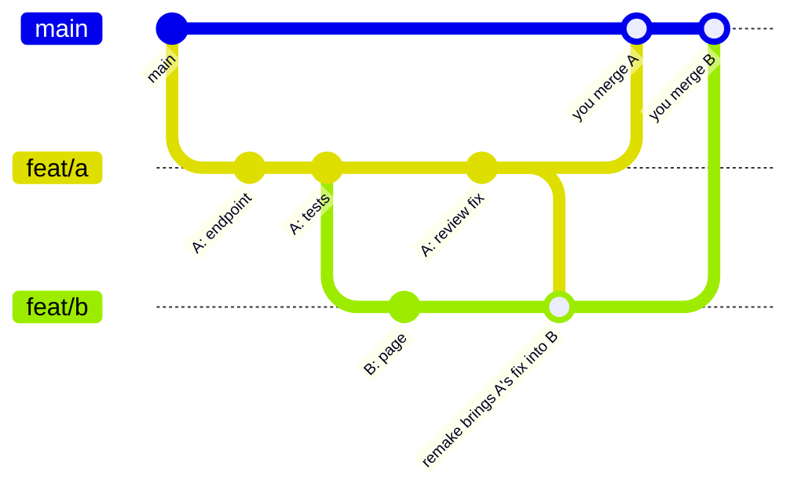

B's pull request targets main. Until A merges, it also shows A's changes; after, it shows only B's. You merge in
order, A then B.

When B starts, the loop records which commit of A it was built on. If A later gets new commits, B is out of date:

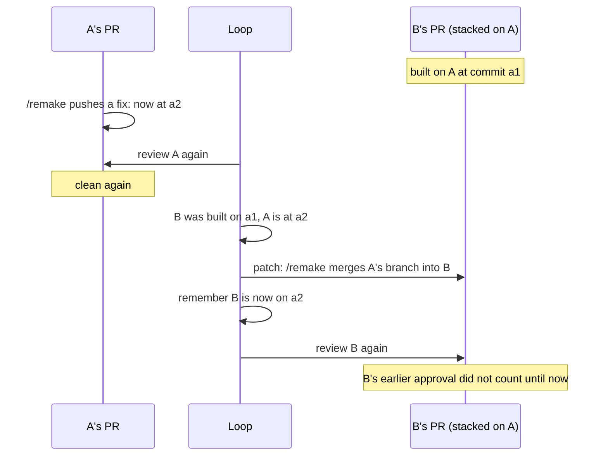

If you delete A after B was stacked on it, B is kept exactly as it is. Deleting a task does not mean its work is
unwanted, and merging B lands it.

## When things go wrong

One failure never stops the loop. Everything that does not depend on the failed task keeps running.

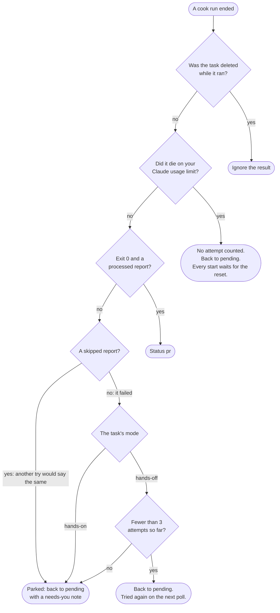

- **Parked.** The task waits until you press **Retry** on its row in the visualizer, which clears the note and the
  attempt count.
- **Usage limit.** The loop reads the reset time from the agent's output when it is there, and waits 30 minutes when
  it is not. The visualizer's top bar shows when work resumes. It resumes by itself.
- **Crash.** If the factory dies while agents run, the next start finds tasks marked in progress with no agent. Each
  goes back to pending with no attempt counted. Its worktree is removed, and its half-finished branch too if it has
  no PR yet.
- **Pause.** You can pause the whole factory or one project. Paused, a loop starts nothing new; running agents
  finish.

## Projects and project dependencies

Tasks never depend on tasks in another repository. When one repository needs another's work first, for example
because it uses it as a submodule, the dependency is between the projects.

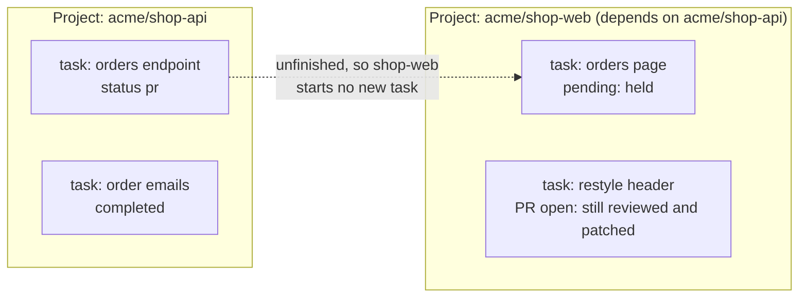

The rule: while any project it depends on has a task that is not completed, a project starts no new task. Reviews
and patches of its existing PRs carry on.

This gate always means merged, whatever the modes. Inside one repository a task can be stacked on an unmerged
branch. Across repositories there is nothing to stack on; one repository only sees what is in another's main.

The gate is checked each time a task is about to start. If the project you depend on gets new work, your running
agents finish and your not-yet-started tasks wait again. You set what a project depends on in its heading in the
visualizer. A dependency that would make two projects wait for each other is refused.

## Changing a task after its PR is open

Comment `/customize_order <what should change>` on a task's PR. The loop leaves that PR alone, and the visualizer
hosts the `/customize_order` run, asking you its questions on the PR's run page.

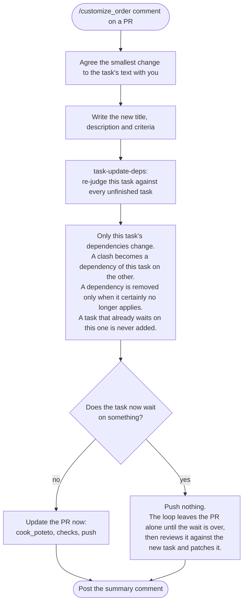

The changed task is treated as the newcomer. Tasks that were running when you changed it finish untouched, and their
dependencies do not change.

## Deleting and completing

**Completing.** A task becomes completed when the loop sees its own PR merged into main, or when you press **Mark
completed**. Either way it is kept for its history, nothing touches it again, and the tasks that waited for it are
released. A wrong or reverted merge is fixed with a new order, not by reopening.

**Deleting.** You can delete a task, a whole session, or a whole project from the visualizer. Each asks first and
lists what it will do.

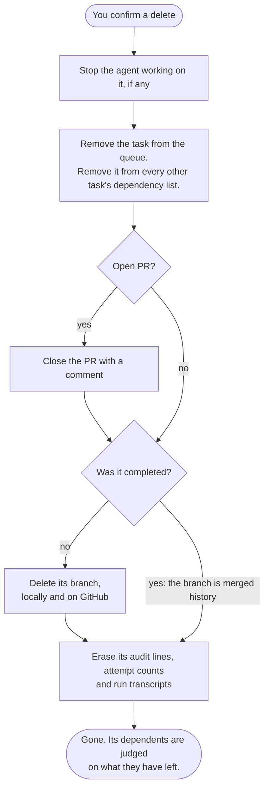

A step that fails on GitHub or in git is reported as a warning. It never keeps the task alive: the factory's own
records are always erased. GitHub keeps a closed PR in its own history; that cannot be erased.

Deleting a session deletes each of its tasks. Removing a project deletes all of its tasks, stops its loop, and drops
it from every other project's depends-on list. The repository's code and its main branch are not touched.

## What is code and what is a skill

One test decides it: can the rule be settled from recorded facts alone? If yes, it is code with tests, so it behaves
the same every time. If it needs reading a repository and judging, it is a skill.

| Rule | Lives in | File |
|---|---|---|
| May this task start now | Code | `factory/gate.ts` |
| What "passed review cleanly" means | Code | `factory/gate.ts` |
| Which mode applies | Code | `factory/settings.ts` |
| What a PR needs next | Code | `factory/pr-state.ts` |
| What to start first, and how many at once | Code | `factory/candidates.ts`, `factory/loop.ts` |
| Retries, parking, usage limit, crash recovery | Code | `factory/loop.ts` |
| Which tasks to compare a task against | Code | `factory/deps.ts` |
| Writing dependencies, refusing deadlocks | Code | `factory/deps.ts` |
| May this project start a task | Code | `factory/projects.ts` |
| Deleting a task | Code | `factory/delete-task.ts` |
| Do these two tasks clash | Skill | `task-pair-check` |
| A new order's dependencies | Skill | `task-determine-deps` |
| A changed task's dependencies | Skill | `task-update-deps` |
| Doing the work | Skills | `cook`, `taste_test`, `remake` |

A skill never decides whether something may run. Skills write dependencies and their reasons through
`factory deps set`; the loop's code alone decides what starts.

## The visualizer

`bun run viz` serves the visualizer on `127.0.0.1:4600`. It reads every project's queue and audit log, each
repository's PRs, and the agents' transcripts, and polls every half second.

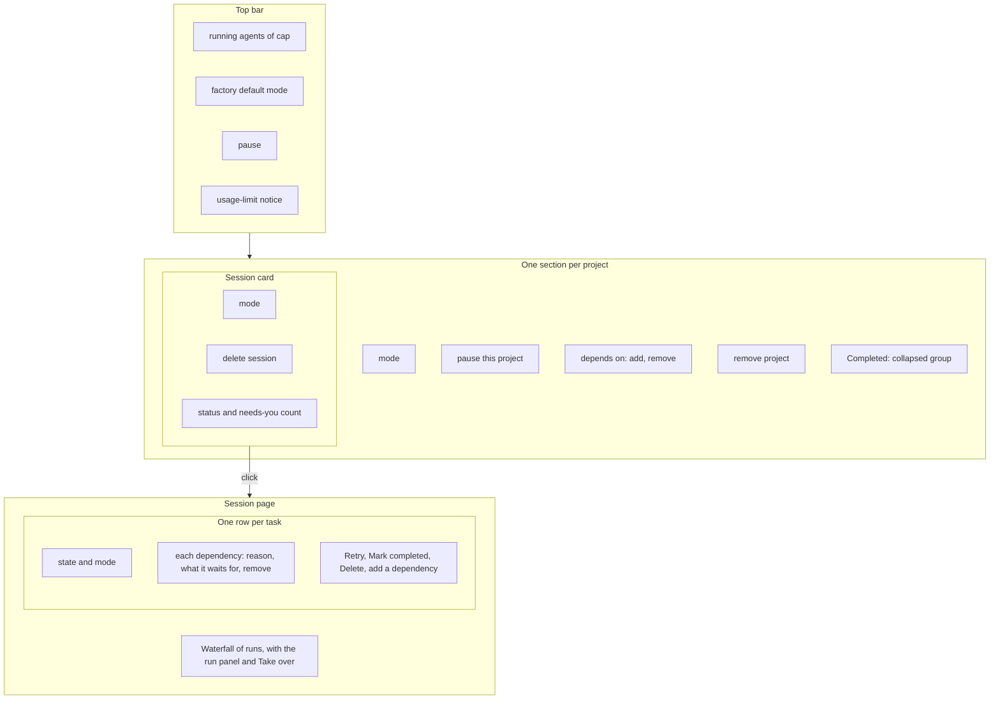

The visualizer writes to the factory's data only through those controls. It also hosts `/customize_order` runs and
can open a Terminal that resumes an agent's conversation.

## Module map

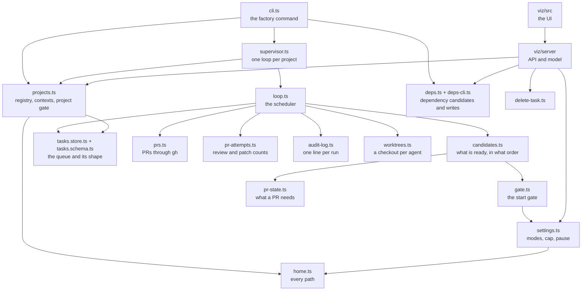

Tests sit beside each module as `*.test.ts`. `bun test` runs them all.

## Known limits

- **Checks must run with Bun.** Agents may run `bun`, `git`, `gh` and a few read-only commands. `/cook` cannot run a
  repository's checks if they need `npm`, `pytest`, `cargo` or another tool.
- **Usage-limit detection matches known wording.** If Claude Code words the message differently, the run counts as
  an ordinary failure.
- **GitHub only.** A project needs a GitHub `origin` remote.
- **Agents start from `origin/main`.** A change to the skills takes effect for the loop's agents once it is merged.
- **Session and task ids are looked up across projects.** Two repositories using the same task id would confuse the
  visualizer's task actions. Session ids carry a timestamp, so they do not collide in practice.
- **Merging and closing PRs is yours.** No agent does either.
